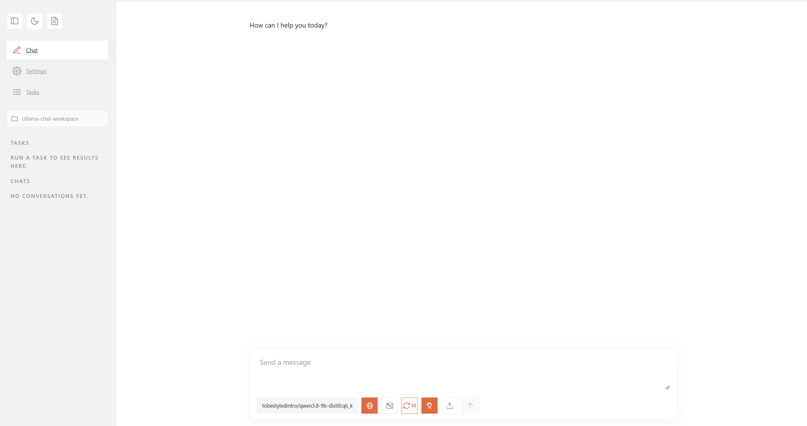
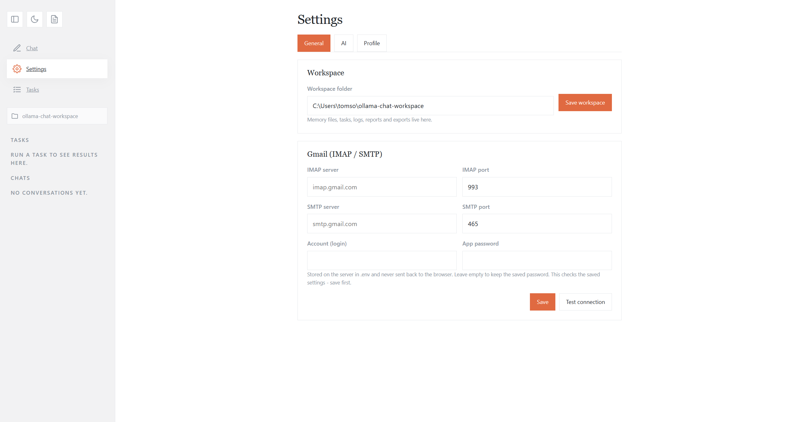
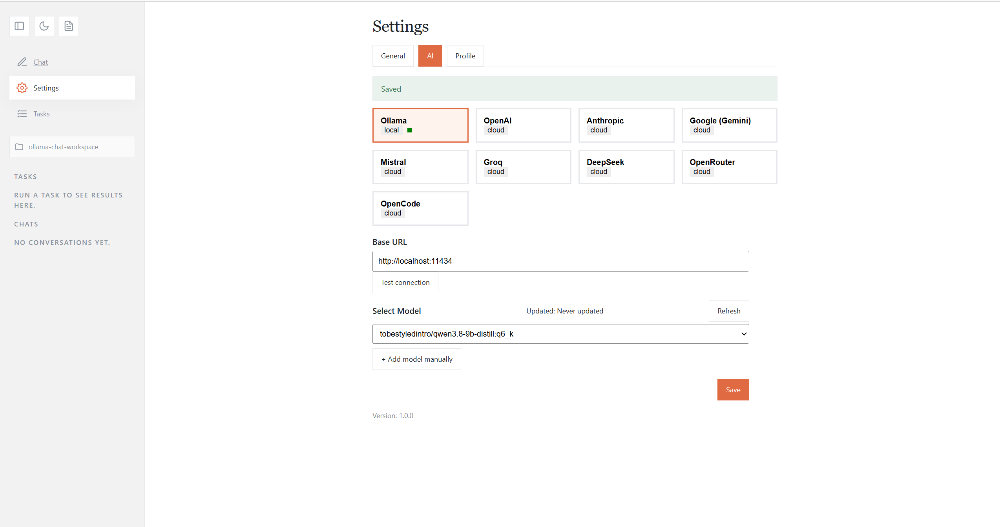
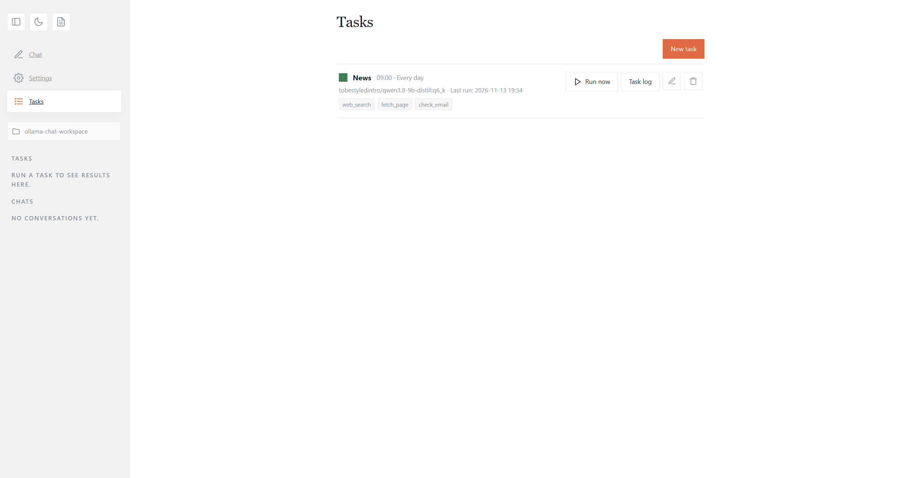

# ollama-chat

[](https://pypi.org/project/ollama-chat/)
[](https://pypi.org/project/ollama-chat/)
[](https://github.com/craigahobbs/ollama-chat/blob/main/LICENSE)
[](https://pypi.org/project/ollama-chat/)

**Ollama Chat** is a conversational AI chat client that uses [Ollama](https://ollama.com) to interact with local large language models (LLMs) entirely offline. Private, fast, no cloud.

> **Fork:** [OlegUshakov-pl/ollama-chat](https://github.com/OlegUshakov-pl/ollama-chat) — fork of [craigahobbs/ollama-chat](https://github.com/craigahobbs/ollama-chat) with redesigned UI, thinking mode, file attachments and markdown preview.

## What's new in this fork

- **Completely redesigned theme** — light / dark (`prefers-color-scheme` + `data-theme`), new sidebar / composer / messages layout, mobile-responsive. See `src/ollama_chat/static/app.css` and `src/ollama_chat/static/app.js`.
- **Thinking mode toggle** — paw button in composer. Sends `{"think": true|false}` via `startConversation` / `replyConversation` → `ChatManager(think=...)` → `ollama_chat(..., think=...)` (`src/ollama_chat/ollama.py:43`, `src/ollama_chat/chat.py:23`). Persisted in `localStorage` (`ollama-chat-thinking`). Visual state `icon-btn thinking-active` (`src/ollama_chat/static/app.css:777`).
- **Web search (tool calling)** — globe button left of the thinking paw. Sends `{"search": true|false}`, the back-end hands Ollama two tools (`web_search`, `fetch_page`) and runs the `tool_calls` loop (max 5 rounds per answer) → `ChatManager(search=...)` → `ollama_chat(..., tools=...)` (`src/ollama_chat/web_tools.py`, `src/ollama_chat/chat.py`). Persisted in `localStorage` (`ollama-chat-websearch`), off by default. Active class `icon-btn websearch-active`; used tools are shown as a collapsible block in the chat.
- **File attachments** — upload button in composer, **up to 10 files per message** (selected files accumulate, each chip has a remove button, `3 / 10` counter). Supported: `txt`, `md`, `docx`, `png`, `jpg`, `jpeg`. Text is appended to user message, `docx` parsed with `python-docx`, images sent as base64 `images` (`src/ollama_chat/chat.py:67`, `src/ollama_chat/static/app.js:149`). Attached file names are stored on the exchange (`ConversationFileRef`) and shown as chips above each user message, sending with empty text allowed.
- **Markdown viewer (.md preview in chat)** — button next to theme toggle in sidebar toolbar. Opens system file picker (`accept=".md,.markdown"`), reads file with `FileReader` and renders it **inside the chat area** via `marked` + `DOMPurify` (`src/ollama_chat/static/app.js:505`, `src/ollama_chat/static/app.css:987`). Header shows filename + `Close preview` button, `Esc` also closes. No upload to server, works offline.
- **Reliable rename** — `Rename` in chat menu now updates both sidebar and open header instantly and awaits `POST /setConversationTitle` before navigation (`src/ollama_chat/static/app.js:885`, `src/ollama_chat/static/ollamaChatConversation.bare:312`).
- **One-click Windows launch — `start.bat` / `install.bat`** — `install.bat` clones to clean folder + creates `.venv`, `start.bat` creates `.venv` if missing and forwards all args to `ollama-chat` (e.g. `start.bat -p 8080`).
- **Workspace & long-term memory** — a directory on disk (`~/ollama-chat-workspace` by default) holding `USER.md` (about the user) and `MEMORY.md` (durable notes). The memory is injected into the system prompt for every model turn (`src/ollama_chat/memory.py`), managed from the chat with `/memory`, `/remember`, `/forget`. Set on the **Settings** page (`#/settings`) or via the `OLLAMA_CHAT_WORKSPACE` env var.
- **Settings and Tasks pages** — the home page is chat-only now: workspace and Gmail (IMAP/SMTP) settings moved to **Settings** (`#/settings`), the task manager moved to **Tasks** (`#/tasks`). The sidebar shows the workspace name and `Settings` / `Tasks` links. The server binds to `127.0.0.1` only.
- **Gmail / email settings in the app** — IMAP/SMTP host+port, login and an app password are edited on the Settings page and written to `<workspace>/.env` (same format as `.env.example`). The password is write-only: it is never stored in `ollama-chat.json`, never committed to git and never sent back to the browser (only a `hasPassword` flag is returned). **Test connection** logs in to both servers without sending anything.
- **Profile page (`#/profile`)** — a form (name, profession, country, city, time zone, languages, interests, equipment, reply style, …) that fills `memory/USER.md`; the form can be switched to a raw **Text** mode to edit `USER.md` as markdown. `USER.md` is added to the system prompt of every message (character limit: config key `profileLimit`, default `1500`), and the current date and time (time zone from `USER.md`'s `Timezone` line, or local) are injected with it. API: `GET /getProfile`, `POST /setProfile`.
- **AI Providers (`#/settings` → AI)** — cloud providers (OpenAI, Anthropic, Google/Gemini, Mistral, Groq, DeepSeek, OpenRouter, OpenCode) plus any custom OpenAI-compatible server. Each provider has its own API key (stored AES-GCM encrypted), base URL and default model; keys are write-only and never sent to the browser. Select a provider by card, check the key, refresh the model list. Ollama remains the default provider.

## Quick start

Requirements: [Ollama](https://ollama.com/download) running + Python 3.11+ and Git on `PATH`.

### Option A — via `install.bat` (Windows, recommended)

1. Create empty folder, copy `install.bat` into it (or [download](https://github.com/OlegUshakov-pl/ollama-chat/raw/main/install.bat)).
2. Double-click `install.bat`.

   Clones to `.\ollama-chat`, creates `.venv`, `pip install -e .`.

3. 
   ```bat
   cd ollama-chat
   start.bat
   ```
   Opens http://127.0.0.1:8080/ , config is `ollama-chat.json` in home directory.

### Option B — via `start.bat` (already cloned)

```bat
git clone https://github.com/OlegUshakov-pl/ollama-chat.git
cd ollama-chat
start.bat
```

`start.bat` creates `.venv` if missing, cleans stale `~*` in `site-packages`, installs if needed, runs `ollama-chat %*`.

> If `OLLAMA_HOST` != `http://127.0.0.1:11434`, set env var before launch — see `src/ollama_chat/ollama.py:19`.

## Manual installation

**macOS / Linux**
```sh
python3 -m venv $HOME/venv --upgrade-deps
. $HOME/venv/bin/activate
pip install -e .   # or pip install ollama-chat for upstream
ollama-chat
```

**Windows (without bat)**
```bat
python -m venv %USERPROFILE%\venv --upgrade-deps
%USERPROFILE%\venv\Scripts\activate
pip install -e .
ollama-chat
```

CLI shortcuts:
```sh
ollama-chat -m "Why is the sky blue?"
ollama-chat -t askAristotle -v question "Why is the sky blue?"
```

## Features

- Offline chats with local LLMs, multiple concurrent conversations
- **Thinking toggle** (paw, `thinkingOn`/`thinkingOff`, respects model `capabilities` fallback)
- **Web search toggle** (globe) — the model searches the web and reads pages by itself (tool calling), SSRF-protected
- **File uploads** — up to 10 files per message (`txt`/`md`/`docx` as text, `png`/`jpg`/`jpeg` as images)
- **Markdown viewer** — open local `.md` files in chat area, rendered safely
- **Rename / Delete / Download .md / Regenerate** per chat
- Prompt commands `/file`, `/dir`, `/image`, `/url`, `/memory`, `/remember`, `/forget`, `/do`, `/?`, `/tasks`, `/task`
- **Workspace memory** (`USER.md` + `MEMORY.md`) injected into every model turn
- **Settings page** (`#/settings`) — workspace folder and Gmail IMAP/SMTP settings with a connection test; the app password lives in `<workspace>/.env` only
- **Scheduled tasks** (cron) — daily/weekly reports run by the in-app scheduler or Windows Task Scheduler, saved to workspace memory; managed on the Tasks page (`#/tasks`)
- Conversation templates with `{{var}}` substitution
- Model browser, download, monitor, selection, streaming
- Show/hide thinking, Markdown/text view, export as Markdown
- Light / dark themes, responsive layout
- Local-only server — binds to `127.0.0.1` and is not reachable from the network

## Usage

### Thinking mode
Paw button left of upload in composer. Persisted across restarts. Included as `{"think": bool}`. Backend honors explicit value otherwise falls back to model capabilities (`src/ollama_chat/ollama.py:57`). Active class `icon-btn thinking-active`.

### Web search
Globe button left of the paw button in composer. Persisted across restarts (`localStorage` key `ollama-chat-websearch`, off by default) and included as `{"search": bool}` in `startConversation` / `replyConversation`.

When it is on, the back-end sends Ollama a `tools` array with two functions (`src/ollama_chat/web_tools.py`):

- `web_search(query, max_results = 5)` — DuckDuckGo search via the `ddgs` package, returns `{title, url, snippet}`
- `fetch_page(url)` — downloads a page, extracts the readable text with `trafilatura` (trimmed to 6000 characters)

The model decides when to use them. Every `tool_calls` round is executed, its result is appended to the messages as a `tool` role message and the request is repeated — at most **5 rounds per answer**, after which the tools are withdrawn so the model has to answer. Tool failures are returned to the model as plain text (`Error: ...`) instead of failing the request. Each exchange remembers what the model used (`ConversationTool {action, value}`) and shows it as a collapsible block in the chat (`🔍 Search: <query>` / `🌐 Opened page: <url>`).

The round limit is per chat: the refresh-with-count button left of the paw in the composer cycles it through 1 / 3 / 5 / 10 / 20 (persisted in `localStorage` key `ollama-chat-toolrounds`, default 5) and sends it as `{"toolRounds": n}` in `startConversation` / `replyConversation`. Scheduled tasks have their own limit: the `Tool call rounds` select in the task form (default 5), stored as `tool_rounds` in `tasks.json`.
If the model has no `tools` capability (checked via `/api/show` `capabilities`, like `think` for thinking), the search is turned off for that run and a notice is added to the answer.

**SSRF protection** — only `http`/`https` URLs; the host is resolved and all of its addresses must be public (loopback, private, link-local, CGNAT, multicast and reserved ranges are rejected), redirects are followed manually (at most 5 hops) with every hop re-checked, the response is limited to 2 MB and read timeouts are 10 seconds. Targets such as `localhost`, `127.0.0.1`, `10.x`, `192.168.x`, `169.254.169.254` and `[::1]` are blocked, and the model never sees raw stack traces.

**Recommended models** — any model with tool-calling support: `qwen3`, `llama3.1`, `mistral`, `gemma3`, `kimi-k2`, `qwen2.5-coder` and similar. Check yours with `ollama show <model>` — the `Capabilities` line must contain `tools`.

### File attachments
Click upload icon → select one or more files (up to 10, `multiple`) → each file appears as a removable chip above the composer controls with a `n / 10` counter → Send. New selections are **added** to the current ones; a banner appears if you try to attach an 11th file or an unsupported type. Read via `FileReader` (`src/ollama_chat/static/app.js:171`), attached server-side (`src/ollama_chat/chat.py:67`). The attached file names are saved on the exchange and rendered as chips above the user message for the whole conversation; they are also included in the `.md` export as `**Files:** ...`.

### Markdown viewer
1. Click document icon **next to theme button** in top-left toolbar (sidebar).
2. Pick a `.md` / `.markdown` file.
3. File content renders **in the chat area** (`messages` pane) as sanitized Markdown (`window.marked` + `window.DOMPurify`). Header shows filename.
4. `Close preview` button or `Esc` or navigation clears `state.mdViewer` and returns to chat. State is in-memory only, not sent to server. Code blocks get language label + copy button via `enhanceCodeBlocks()`.

### Prompt commands
Implemented in `src/ollama_chat/chat.py`:

- `/file README.md` — include file
- `/image image.jpeg` — include image
- `/dir src/ollama_chat py` — include directory files
- `/url https://...` — include URL resource
- `/memory` — show the workspace memory files (`USER.md`, `MEMORY.md`)
- `/remember likes tea` — add a line to `MEMORY.md`
- `/forget tea` — list memory lines matching a phrase; `/forget -y tea` — delete them (previous `MEMORY.md` is saved as `MEMORY.md.bak`)
- `/do city-report -v CityState "Seattle, WA"` — execute template
- `/?` — list commands, `/file -h` for help

### Workspace and memory
The workspace is a directory where the assistant keeps long-term memory:

```
<workspace>/memory/USER.md      # background information about the user
<workspace>/memory/MEMORY.md    # notes remembered across conversations
<workspace>/memory/daily/YYYY-MM-DD.md   # scratchpad for dated notes
```

**Choosing the workspace** — priority order:
1. Config key `workspace` in `ollama-chat.json` (set on the **Settings** page → **Workspace** → **Save workspace**, or `POST /setWorkspace`; the folder is created if needed and its existence/writability is verified server-side)
2. Environment variable `OLLAMA_CHAT_WORKSPACE`
3. Default: `~/ollama-chat-workspace`

**Configuring memory size** — config key `memoryLimit` (characters of memory injected into the system prompt, default `3000`; `0` disables injection). When `MEMORY.md` exceeds the limit, only lines matching keywords from your current prompt are injected (falling back to the most recent lines if nothing matches).

**How it works** — `USER.md` and `MEMORY.md` are read before each model turn (`src/ollama_chat/memory.py`) and injected as a `system` message, together with the **current date and time** (the time zone comes from `USER.md`'s `- Timezone:` line, e.g. `Europe/Warsaw`; without it the local time zone is used). Memory-only commands (`/memory`, `/remember`, `/forget`) answer locally without calling the model.

Usage examples:
```
/remember I prefer concise answers
/remember Project Nova deadline is 2026-03-01
/forget Nova
/forget -y Nova
```

### Profile page
The Profile page (`#/profile`, link `Profile` in the sidebar) is a convenient editor for
`memory/USER.md` — the background information about you that is added to the system prompt of
**every** chat message.

**Form mode** — fields: **Name**, **Profession**, **Country**, **City (optional)**,
**Time zone** (IANA name, e.g. `Europe/Warsaw` — used for the injected current date and time),
**Languages**, **Reply language**, **Interests**, **Equipment**, **Not interested in**,
**Reply style** and a free-form **Other** field. **Save** writes the fields to
`memory/USER.md` (sections `# About the user` and `# Preferences`, one `- Key: value` bullet per
field):

```markdown
# About the user

- Name: Oleg
- Profession: CAD engineer, 20+ years of experience
- Country: Poland
- Timezone: Europe/Warsaw
- Languages: Russian (native), Polish and English (advanced), German (basic)
- Interests: programming, static websites, local LLMs
- Equipment: laptop i9-13900HX, RTX 4070 8 GB, 32 GB RAM

# Preferences

- Reply language: Russian unless asked otherwise
- Not interested in: Russia news; search Polish news on Polish sites in Polish
- Reply style: brief and to the point
```

**Text mode** — switches the page to a raw `USER.md` editor (markdown, as-is). You can keep
your own sections/bullets there; the form reads known `- Key: value` bullets (case-insensitive)
and keeps unknown lines in **Other**.

**Character counter** — the page shows the content length against the limit (config key
`profileLimit`, numbers of characters, default `1500`); the save button is disabled and the
server rejects the save while the content is over the limit. A warning under the form:
do **not** enter passwords, secret keys, exact home address or document numbers — `USER.md`
is sent to the model with every message.

API: `GET /getProfile` (content + `limit`), `POST /setProfile` (errors `ProfileTooLong`,
`BadProfile`).

### Settings page
The Settings page (`#/settings`, link `Settings` in the sidebar) holds everything that used to
live in forms on the home page.

**Workspace** — the workspace folder path and a **Save workspace** button (see above). Memory
files, `tasks.json`, `logs/`, `daily/` reports and PDF exports all live under this folder.

**Gmail (IMAP / SMTP)** — for the email tools (`check_email` in chat, `send_email` / `check_email`
in scheduled tasks):

| Field | Meaning |
|---|---|
| IMAP server / IMAP port | e.g. `imap.gmail.com:993` (implicit SSL) |
| SMTP server / SMTP port | e.g. `smtp.gmail.com:465` (implicit SSL) or `:587` (STARTTLS) |
| Account (login) | your e-mail address, e.g. `you@gmail.com` |
| App password | a Google **application password**, not your main one |

**Where the password is stored** — all of the above is written to **`<workspace>/.env`**
(the first `.env` file read from — see `.env.example` for the plain-text format):

```
EMAIL_IMAP_HOST=imap.gmail.com
EMAIL_IMAP_PORT=993
EMAIL_SMTP_HOST=smtp.gmail.com
EMAIL_SMTP_PORT=465
EMAIL_USER=you@gmail.com
EMAIL_PASSWORD=your-application-password
```

The app password is write-only by design:

- it is **never** stored in `ollama-chat.json` (the config file) and must never be committed to git (`.env` is in `.gitignore`);
- opening the Settings page again shows the password field **empty** with a `(saved)` placeholder — the saved password is never sent back to the browser, only the `hasPassword` flag;
- saving with an empty password keeps the previously saved password.

**Test connection** — logs in to the configured IMAP and SMTP servers (SMTP login only, no e-mail
is sent) and reports success or a per-protocol error.

### Scheduled tasks
Tasks run a prompt on a schedule (like cron) without a conversation: they read the workspace memory,
may use the web tools (`web_search`, `fetch_page`), generate a report with the same tool-calling loop
as a chat, and **append the report to `<workspace>/memory/daily/YYYY-MM-DD.md`** with the task name
and time as the heading. When the tool call budget is exhausted the task, like a chat, appends the
final-answer prompt so the model writes its report; a run that still comes back empty (some models
reply with phantom tool calls) retries the final round once, and an empty report is recorded as an
error in `lastError`. Errors never crash the scheduler — they are logged to
`<workspace>/logs/YYYY-MM-DD.log` and shown in `/tasks` and on the Tasks page.

Tasks are stored in `<workspace>/tasks.json` — each task has `id` (unique, derived from the name),
`name`, `time` (`HH:MM`), `days` (ISO weekdays `1=Mon`…`7=Sun`), `prompt`, `model`, `num_ctx`,
`tools`, `enabled`, `dest`, plus the `lastRun`/`lastError` maintenance fields. Tasks created before
the `enabled` field (or without it) are enabled.

### Tasks page
The Tasks page (`#/tasks`, link `Tasks` in the sidebar) manages `tasks.json` directly:

- **list** — every task with its enable-toggle (`enabled` on/off, a disabled task never runs and is
  skipped by the scheduler), schedule (`HH:MM · days`), model, tools, last run time and last error;
  the list refreshes every 4 seconds while the page is open;
- **New task / Edit** — a form with name, run time, run days (Mon–Sun toggles), prompt text, model
  picker, `num_ctx` (empty = default) and allowed tools. `send_email` is **opt-in** (unchecked by
  default): a task sending e-mail has no confirmation step, so it only works when the task's tools
  explicitly include it;
- **Run now** — runs the task in the background immediately (the result appears in the workspace
  `memory/daily/` report and in the task's log). While the task runs the list shows a "Running…"
  spinner for it and the "Run now" button is disabled;
- **Log** — the task's run log (the lines mentioning the task in `<workspace>/logs/*.log`,
  newest first);
- **Delete** — with a confirmation dialog.

The prompt commands from before still work identically:

```
/tasks                                   # list tasks (same as /task list)
/task add "Morning briefing" -t 09:00 -d weekdays -m llama3.1 Make a briefing of my memory and the news about AI
/task add name -t HH:MM [-d all|weekdays|weekends|1,3,5] [--ctx N] [--tools web_search,fetch_page] prompt...
/task run briefing                        # run the task once now
/task remove briefing
```

Default `-d` is `all`. Default `--tools` is `web_search,fetch_page,check_email` (adding
`send_email` to `--tools` opts the task in to sending e-mail, see above). The default model is the
current model. If the time-slot is skipped (app off), the task is missed - by default there is no
catch-up run at startup; set the config key `tasksCatchUp` to `true` to enable it. A running task
can be stopped with the tasks page's stop button.

### Conversation templates
- **Create:** `Add Template` (home) or `Template` (conversation page)
- **Run:** click title on home; if variables `{{var}}`, prompts for values then creates conversation
- **Edit:** home → `Select` → `Edit` (title, name, variables, prompts)

**Running tasks with the Windows Task Scheduler** — the `run_task.py` script runs one task and
exits, so the app doesn't need to be running:
```
schtasks /Create /TN "Ollama Briefing" /SC DAILY /ST 09:00 ^
  /TR "python D:\path\to\run_task.py briefing" /SC DAILY
python run_task.py -c "%USERPROFILE%\ollama-chat.json" briefing
```
The script prints the report to stdout, exits with code 0 on success and 1 on failure (the failure
is also logged to the workspace `logs` directory).

### Scheduled task example
Every day at 9:00 — briefing from memory and fresh news on a topic (Russian):
```
/task add "Утренний брифинг" -t 09:00 -d weekdays Прочитай мою память и найди свежие новости по теме ИИ. Сделай краткий брифинг: что важно сегодня.
```
The report is saved to `memory/daily/YYYY-MM-DD.md` as `## Утренний брифинг (09:00)`.

### PDF export
The **Export PDF** button (next to **Download** in the conversation menu) renders the current
conversation as a PDF file on the server and saves it to `<workspace>/exports/`. A note appears at
the bottom of the page with the exported file path, e.g. `PDF exported to
ollama-chat-workspace/exports/conversation-1.pdf`. A duplicate title gets a numbered file name
(`…-1.pdf`, `…-2.pdf`).

Rendering is done with [fpdf2](https://github.com/py-pdf/fpdf2) (pure Python — no GTK, WeasyPrint
or other heavy Windows dependencies) and the bundled DejaVu fonts, so **Cyrillic and Latin-2
(Polish) letters are supported**: headings, lists, tables, monospace code blocks and quotes are
formatted. Workspace memory files can be exported through the API too:

```
POST /exportPdf  {"id": "<conversation id>"}     # a conversation
POST /exportPdf  {"file": "USER.md"}             # <workspace>/memory/USER.md
POST /exportPdf  {"file": "MEMORY.md"}           # <workspace>/memory/MEMORY.md
POST /exportPdf  {"file": "daily/2026-01-15.md"} # <workspace>/memory/daily/YYYY-MM-DD.md
```

### Interface and themes

The UI uses a clean, minimal style (Jan AI / Claude Code inspired): a flat white light theme with
straight corners (`--radius: 0`) and a dark theme, a compact sidebar, a centered chat column,
collapsible thinking and tool-call blocks, and code blocks with a copy button. Theme choice is persisted
in `localStorage` and follows `prefers-color-scheme` by default. The sidebar collapses on mobile and
opens via the menu button.

The sidebar doubles as the app navigation: **Chat** (new chat), **Settings** and **Tasks** links and
the current workspace folder name; below it is the chat list. The home page itself is chat-only —
no workspace/tasks forms.

## Add a desktop launcher

**macOS** — drag `ollama-chat` executable to Dock.

**Windows** — right-click `ollama-chat.exe` → Pin to Start; or pin `start.bat`.

**GNOME (Linux)**
```
[Desktop Entry]
Name=Ollama Chat
Exec=sh -c "$HOME/venv/bin/ollama-chat"
Type=Application
Icon=dialog-information
Terminal=true
Categories=Utility;
```
```
nano $HOME/.local/share/applications/ollama-chat.desktop
```

## File format and API

[Ollama Chat File Format](https://craigahobbs.github.io/ollama-chat/api.html#var.vName='OllamaChatConfig')
[Ollama Chat API](https://craigahobbs.github.io/ollama-chat/api.html)
Schema: `src/ollama_chat/static/ollamaChat.smd` — fork adds `think`/`files`/`search` to `StartConversation`/`ReplyConversation`/`StartTemplate`, `tools` to `ConversationExchange`, `tasks`/`TaskInfo` to `getConversations`, `workspace`/`memoryLimit`/`tasksCatchUp` to `OllamaChatConfig` plus the `setWorkspace` endpoint, and the `exportPdf` endpoint. The Settings/Tasks pages add the `getSettings`, `setEmailSettings`, `testEmailConnection`, `getTasks`, `setTask`, `deleteTask`, `runTask` and `getTaskLog` endpoints with the `TaskDetails`/`TaskInput`/`TaskLog`/`EmailSettings`/`SettingsInfo` types.

## Development

Built with [python-build](https://github.com/craigahobbs/python-build#readme). Started via [python-template](https://github.com/craigahobbs/python-template#readme):
```
template-specialize python-template/template/ ollama-chat/ -k package ollama-chat -k name 'Craig A. Hobbs' -k email 'craigahobbs@gmail.com' -k github 'craigahobbs' -k noapi 1
```
```sh
make test        # backend tests (urllib3 mocked)
make test-app    # BareScript frontend tests (TEST="exact name")
make lint        # + pylint on static/models/models.py
make run ARGS='...'  # start app from default venv
```

Upstream: https://github.com/craigahobbs/ollama-chat · Fork: https://github.com/OlegUshakov-pl/ollama-chat





